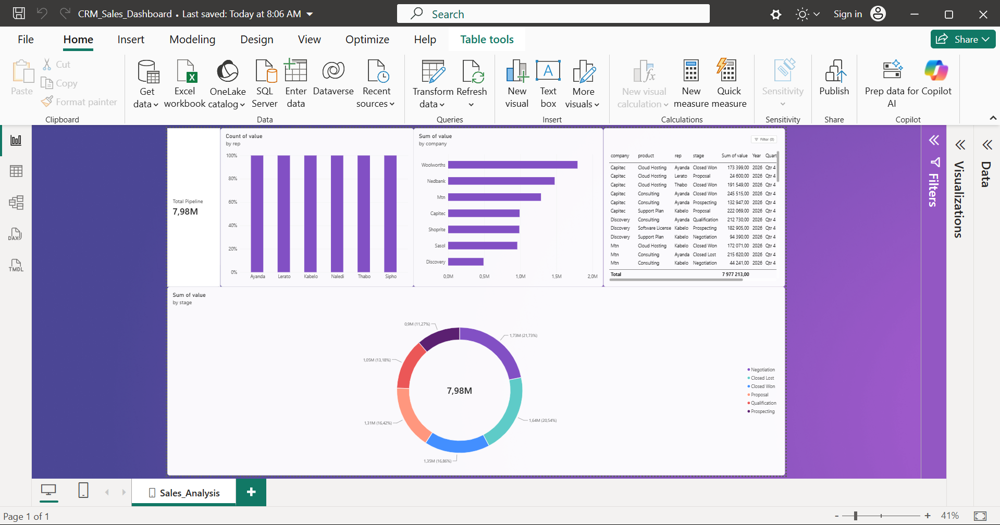

# CRM Sales Data Pipeline | Azure + Python + SQL + Power BI

End-to-end Data Engineering project. Built a live sales dashboard tracking **R7.98M** in pipeline, from REST API to Power BI.

## Architecture

REST API → Azure Data Lake Gen2 (Raw JSON) → Python / Pandas (Clean + Validate) → Azure SQL (Deals_Silver) → Power BI Dashboard

## What I Built

**1. Extract**
- Pulled deals from REST API
- Landed raw JSON in Azure Data Lake Gen2

**2. Transform (Python / Pandas)**
- Handled nulls in `value`, `rep`, `company`
- Standardized text in `stage` (e.g. "Closed Won", "In Progress")
- Converted types: `value` → decimal, `close_date` → date
- Removed duplicates on `deal_id`

**3. Load**
- Loaded to Azure SQL Database
- Table: `Deals_Silver`
- Calculated fields: `win_flag`, `value_bucket`, `high_value_flag`

**4. Visualize (Power BI)**
- Total Pipeline: **R7.98M**
- Sales by Rep
- Sales by Company
- Sales by Stage
- Win Rate
- Slicer by Stage

## Tech Stack

- Azure Data Lake Gen2, Azure SQL Database
- Python, Pandas, SQL
- Power BI, DAX
- Git, GitHub, VS Code

## Author

**Nhlalwenhle Shange** - Junior Data Engineer
- GitHub: github.com/NhlalwenhleShange
- Email: nhlalo39@gmail.com
